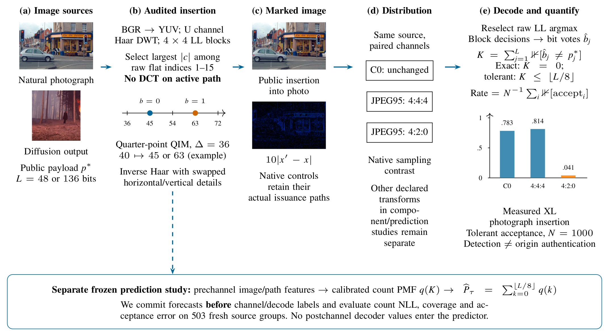
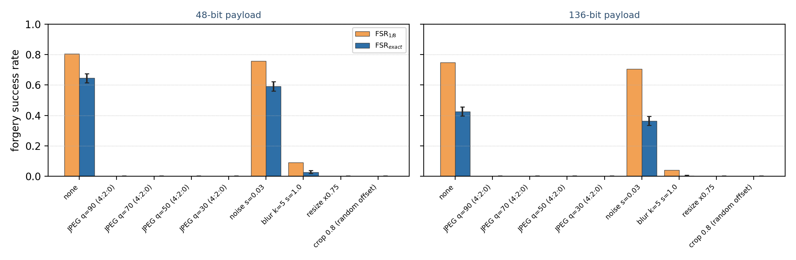

# APFPSDW - Auditing Public Fixed-Payload Stable Diffusion Watermarks

We investigate whether a public fixed-payload watermark can establish generated
origin, which implementation choices explain its errors and distortion, how
distribution channels affect detection, and whether error-count forecasts
predict acceptance reliably.

These materials accompany **Forgeable and Fragile: Auditing Public Fixed-Payload
Stable Diffusion Watermarks**, a manuscript prepared for IEEE Access submission.
We do not claim acceptance or publication.



*Manuscript Fig. 1, cropped from the manuscript PDF without redrawing.
Image-to-decision audit flow. The thumbnails show the historical
photograph/insertion example and a DiffusionDB carrier for illustration
([sources](THIRD_PARTY_NOTICES.md)). Panel (b) depicts a schematic coefficient
lattice. Panel (e) plots the measured XL RF tolerant acceptance from the
native-issuance experiment. The lower branch is the separate prediction study.
Native controls follow their actual issuance paths.*

## 1. Research questions and evidence

| Question | Evidence (manuscript) | Result |
|---|---|---|
| Can payload detection establish generated origin? | H1 public insertion (Table 3); paired photographs, S-F (Tables 5-6); H3 blind and reference access (Table 4) | Exact insertion succeeds on 0.645/0.426 of photographs at 48/136 bits; S-F is supported; H3 holds only under blind guessing |
| Which implementation choices explain the error and fidelity cost? | Source tracing; dtype and detail-order controls (Figs. 2-3) | The active path makes no DCT call and swaps detail subbands; the audited SDXL pipeline passes float32 input to a uint8 encoder |
| When does the mark survive distribution? | Historical channel sweep (Fig. 4); native JPEG95 4:4:4/4:2:0 contrasts (Tables 5-6, Figs. 5-6) | H2 is not supported; survival depends on chroma subsampling as well as quality |
| Can error counts and acceptance be predicted reliably? | Frozen beta-binomial forecasts on 503 fresh groups (Table 7, Fig. 7) | H_BP is inconclusive; H_BT meets its locked criteria with severe undercoverage |

Historical, frozen-prediction and native-issuance cohorts keep separate
denominators and locked criteria; we do not pool them.

## 2. Historical audit (H1-H3)

We tested public-payload insertion on 1,000 COCO photographs and 1,000
DiffusionDB images in 72,000 original CPU decoding trials, using the public
encoder and the published 48/136-bit payloads.

| Photograph insertion (Table 3) | 48 bits | 136 bits |
|---|---:|---:|
| Exact recovery | 0.645 | 0.426 |
| Wilson 95% CI | [0.615, 0.674] | [0.396, 0.457] |
| Tolerant acceptance, BER <= 1/8 | 0.804 | 0.748 |
| Mean BER | 0.077 | 0.098 |
| PSNR (dB) | 36.86 | 36.92 |
| SSIM | 0.9655 | 0.9660 |

The results did not meet the original criteria for H1 or H2. H3 is supported
only under blind guessing: 0/1,000 exact acceptances per payload, with a
one-sided 95% upper bound of 0.0030, below the original 0.004 criterion. The
supplementary 10-key extension gives 0/10,000 key draws, not 10,000 additional
independent images.

| No-attack 48-bit recovery (Table 4) | Exact | Tolerant |
|---|---:|---:|
| Independent secret: legitimate | 501/1004 | 698/1004 |
| Independent secret: blind one-guess | 0/1004 | 0/1004 |
| Independent secret: one reference | 312/1004 | 562/1004 |
| Public payload | 500/1004 | 716/1004 |

With one marked reference, we observed 312/1004 exact acceptances across 251
independent pairs, so secret-string substitution alone does not establish
image-bound authentication. The deployed settings are public. In our verifier
sweep, some alternative settings still recovered the public payload.



*Historical channel survival at 48 bits (left) and 136 bits (right),
manuscript Fig. 4. Blue: exact recovery with Wilson 95% CIs; orange: tolerant
acceptance. JPEG uses 4:2:0 subsampling. These measurements are separate from
the native JPEG95 contrasts below.*

## 3. Implementation mechanisms

- The active path selects the largest of 15 raw LL coefficients per block and
  makes no DCT call.
- The inverse DWT receives swapped horizontal and vertical detail subbands; at
  the deployed step of 36 the swap accounts for 75.2% of the U-channel MSE, and
  removing it raises PSNR to 41.69 dB.
- In the audited SDXL pipeline, the float32 path recovers 0.295 against 0.625
  for the uint8 entry point at 48 bits. A post-hoc control restoring the
  chroma offset raises photograph exact recovery to 0.575 (48-bit) and 0.385
  (136-bit) and closes 85-103% of the float32-uint8 exact-recovery gap across
  the four carrier/payload cells.

## 4. Native issuance and paired photograph controls

In a separate native-issuance experiment, we evaluated 1,000 SDXL base 1.0 and
1,000 original SD v1-4 outputs from 1,000 shared prompt groups, together with
1,000 paired natural photographs (R0) and their public insertions (RF). G
denotes native issuance. C0 has no added channel; C444/C420 use Pillow JPEG
quality 95 with 4:4:4/4:2:0 sampling.

| Payload / role (Table 6) | C0 exact / tolerant | C444 exact / tolerant | C420 exact / tolerant |
|---|---:|---:|---:|
| XL / G | .312 / .375 | .301 / .381 | .018 / .069 |
| XL / R0 | .000 / .000 | .000 / .000 | .000 / .000 |
| XL / RF | .632 / .783 | .668 / .814 | .000 / .041 |
| v1 / G | .224 / .562 | .254 / .630 | .000 / .005 |
| v1 / R0 | .000 / .000 | .000 / .000 | .000 / .000 |
| v1 / RF | .400 / .726 | .438 / .752 | .000 / .000 |

S-F denotes the forgery hypothesis and S-T the subsampling hypothesis.

| Contrast (Table 5) | Difference | One-sided 97.5% lower bound | Declared margin |
|---|---:|---:|---:|
| S-F RF - R0 / XL | .783 | .747882 | .05 |
| S-F RF - R0 / v1 | .726 | .688709 | .05 |
| S-T C444 - C420 / XL RF | .773 | .734752 | .10 |
| S-T C444 - C420 / XL G | .312 | .270223 | .10 |
| S-T C444 - C420 / v1 RF | .752 | .715611 | .10 |
| S-T C444 - C420 / v1 G | .625 | .584420 | .10 |

S-F is supported for the declared public payloads and verifier. All four
subsampling lower bounds exceed 0.10, yet we retain the original
`INCONCLUSIVE_DEPENDENCE_AUDIT` status. A post-hoc cause audit traces all 946
duplicate pairs to 44 identical v1 safety replacements. These outputs are
rejected in every channel; relative to the 956 non-replaced outputs, their
inclusion lowers the v1 G difference from 0.653766 to 0.625. Assigning any
value in [-1, 1] to the 44 unobserved pre-replacement differences gives a
sample-level range of [0.581, 0.669].

The lower bounds are per-contrast and assume binomially sampled prompt-group
discordances; without probability sampling, they are not 97.5% guarantees for
a broader prompt population. For the GPU-only run, we excluded 108 earlier CPU
XL outputs and 237 CPU v1 outputs but reused the prompt list that the earlier
CPU run had partly exposed.

## 5. Frozen count prediction

We selected models on development data, fitted temperatures on 400
calibration groups and evaluated once on 503 fresh test groups. Length-transfer
count metrics use 501 groups; operational rates retain all 503.

| Panel (Table 7) | NLL gain [97.5% group-bootstrap CI] | Mechanism-model 95% coverage | Locked-criteria result |
|---|---|---:|---|
| Primary | .049873 [.035739, .062593] | 98.222% | H_BP inconclusive |
| Unseen order | 1.183341 [1.124283, 1.242648] | 11.804% | H_BT criteria met |
| Longer path | 1.247658 [1.170475, 1.323464] | 7.984% | H_BT criteria met |

Neither transfer panel contains an exact or tolerant acceptance, so the
acceptance-error criterion is uninformative there and H_BT rests on the
relative count-NLL gain alone. Over 5,632 paired warm-cache queries,
prediction took 13.10% more total time than exact replay (153.319 s against
135.562 s).

## 6. Reproduction

### 6.1 Verification levels

| Level | What it checks | Required inputs | In this release |
|---|---|---|---|
| Recount | Tables 5-6: 18 cell rates, mean BER, six paired bounds, 44 safety-replaced outputs in three channels and the original audit hold | `data/native/measurements.jsonl`, `summary.json`, `safety.json` | Yes |
| Re-decode | Decoder outputs from saved images | Saved native and historical images | No; results may depend on the PyWavelets and OpenCV builds |
| Regenerate | Native outputs from prompts | Prompts, model weights, original CompVis code and safety assets | No |

The prediction-study records in `data/prediction/` are aggregates. Our
independent SciPy recomputation of the 409,504 saved rows across five splits
(maximum frozen-PMF and realized-NLL discrepancies 8.08e-14 and 5.01e-13)
requires the raw archive, which we do not release.

### 6.2 Commands

```bash
python -m venv .venv
# Activate the environment with the platform's command.
python -m pip install -r requirements.txt
python tools/verify_release.py
python -m unittest discover -s tests -p "test_*.py" -v
python run_paper_b.py --help
```

`tools/verify_release.py` checks every file listed in
`data/release_manifest.json` against its SHA-256 value, recounts all 18,000
native rows and prints:

```text
PASS: 44 file checksums; {'rows': 18000, 'cells': 18, 'contrasts': 6}; original verdicts retained.
We recount released numerical records, not image generation or the full prediction archive.
```

This recount does not replay native images, rerun generation or establish
prompt independence.

### 6.3 Recorded environment

We recorded Python 3.11.11, NumPy 2.4.6, SciPy 1.17.1, Torch 2.5.1+cu124,
OpenCV 5.0.0, Pillow 12.3.0 and invisible-watermark 0.2.0. PyWavelets runtime
1.8.0 (`pywt.__version__`) differs from installed metadata 1.9.0; the archived
fingerprint does not identify the imported path or binary hash, so
byte-identical dependency reproduction is not guaranteed. A later rerun of the
Fig. 2b control under PyWavelets 1.10.0 reproduced the historical uint8 and
float32 rates exactly in all four carrier/payload cells.

The prediction study evaluates objectives, gradients and PMFs in FP64 with
L-BFGS-B. At the end of each CUDA fit, we compare the objective and gradient at
the fitted weights with a CPU reference; a deviation beyond relative 1e-6
(objective), relative 1e-5 (gradient) or absolute 1e-7 aborts the stage.

### 6.4 Native issuance settings

| Generator | Revision | Settings |
|---|---|---|
| SDXL base 1.0 | `462165984030d82259a11f4367a4eed129e94a7b` | 1024x1024, 30 steps, guidance 5.0, FP16 with VAE upcast |
| Original SD v1-4 | weights `f0bb45b49990512c454cf2c5670b0952ef2f9c71`, CompVis code `21f890f9da3cfbeaba8e2ac3c425ee9e998d5229` | 512x512, PLMS 50 steps, guidance 7.5, CUDA autocast; original safety check before watermarking |

We used seed 20261026 plus the prompt index on one RTX 4090 (24 GB). The RF
lock and the later native locks record sample sizes, hashes, channels, margins,
generation settings and prior exposure; they were not externally
preregistered, and RF measurement preceded the native configuration lock.
[Native evidence and chronology](docs/native_evidence.md) maps Tables 5-6 to
the released records and lists the archived lock hashes.

### 6.5 New component experiments

```bash
python run_paper_b.py --config configs/component.template.json init
```

The template creates a new study with relative output paths and no source
images; it does not reconstruct our completed experiment. Preparation needs
the historical image/index layout expected by `data.py` and fresh source
paths. [Reproduction scope](docs/reproduction.md) lists the data
prerequisites.

## 7. Released materials

| Location | Content |
|---|---|
| `revision_B/src/paper_b/` | Component encoder/decoder, channels, count models, fitting and frozen workflow |
| `run_paper_b.py` | Staged component-study entry point |
| `configs/component.template.json` | Portable new-run template; no image paths or credentials |
| `native/` | Native-generation and audit scripts; external model inputs remain necessary |
| `data/native/measurements.jsonl` | 18,000 anonymized numerical measurements, including all safety replacements |
| `data/native/summary.json` | Aggregate rates, paired contrasts and original statuses |
| `data/prediction/` | Aggregate prediction, access, mechanism, cost and recomputation records |
| `tools/verify_release.py` | Checksums and independent native rate/contrast recount |
| `tests/` | Numerical, release and interface regression tests |
| `docs/reproduction.md` | Recorded environment, execution scope and data prerequisites |
| `docs/native_evidence.md` | Native table-to-record mapping, lock hashes and chronology limits |
| `docs/editorial_audit.md` | Claim-evidence review |
| `docs/citation_audit.md` | Verified page locators and nonpaginated sources |
| `docs/assets/` | Manuscript Figs. 1 and 4 |

## 8. Scope and rights

We release numerical records and our scripts, not original or marked images,
prompt text, model weights, connection details, private logs or IEEE template
assets. The only dataset images in this repository are the Fig. 1 thumbnails
described in [THIRD_PARTY_NOTICES.md](THIRD_PARTY_NOTICES.md). We replace
native source identifiers with stable within-release group labels and record
hashes for the public exports separately from archived execution hashes.

We do not equate watermark detection with origin authentication, absence with
human origin, relative transfer gains with calibrated prediction, or technical
execution with scientific support.

We have not selected a public reuse license for the original contributions.
See [LICENSE_STATUS.md](LICENSE_STATUS.md) and
[THIRD_PARTY_NOTICES.md](THIRD_PARTY_NOTICES.md).
