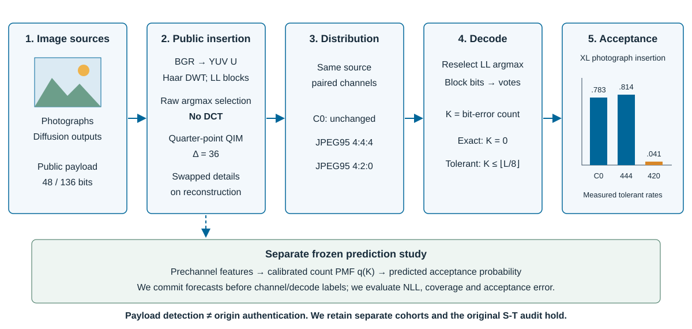
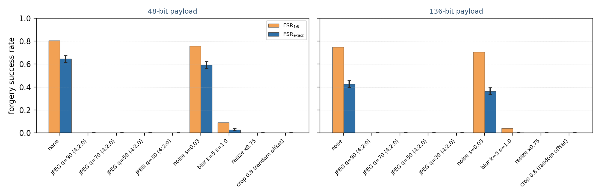

# APFPSDW - Auditing Public Fixed-Payload Stable Diffusion Watermarks

We investigate whether a public fixed-payload watermark can establish generated
origin, which implementation choices explain its errors, how distribution
channels affect detection, and whether error-count forecasts predict acceptance
reliably.

These materials accompany **Forgeable and Fragile: Auditing Public Fixed-Payload
Stable Diffusion Watermarks**, a manuscript prepared for IEEE Access submission.
We do not claim acceptance or publication.



*Public overview of the image-to-decision audit. We use original schematic
icons instead of redistributing dataset thumbnails. The coefficient lattice
is illustrative; the acceptance bars are measured XL photograph-insertion
rates. The prediction branch belongs to a separate, frozen study.*

## 1. Research questions and evidence

| Question | What we compare | What we establish |
|---|---|---|
| Does detection establish generated origin? | Unmarked photographs, public insertion, native issuance, blind and reference access | An accepted public identifier is compatible with nongenerator insertion |
| Which implementation choices matter? | Raw LL coefficient tracing; dtype and detail-order controls | We identify an absent DCT, swapped details and a dtype mismatch, with scoped distortion/error contrasts |
| When does detection survive? | Original channel sweep; paired JPEG95 4:4:4/4:2:0 | Detection depends strongly on the declared channel |
| Can we predict acceptance reliably? | Generic and mechanism-feature count models, frozen before fresh labels | Relative gains do not establish broad calibration or acceleration |

We retain separate cohorts, denominators and predeclared decisions. We do not
pool the original audit, frozen prediction study and native issuance extension.

## 2. Original audit

We evaluated 72,000 decoding trials on 1,000 photographs and 1,000 diffusion
outputs. We used the public encoder and published 48/136-bit payloads.

| Photograph insertion metric | 48 bits | 136 bits |
|---|---:|---:|
| Exact recovery | 0.645 | 0.426 |
| Tolerant acceptance, BER <= 1/8 | 0.804 | 0.748 |
| PSNR (dB) | 36.86 | 36.92 |
| SSIM | 0.9655 | 0.9660 |

We did not meet the original H1 near-unity/quality predictions or H2 durability
criteria. We found support for H3 only for its restricted blind attacker, not
for image-bound authentication or reference-access security.



*Historical channel recovery, corresponding to manuscript Figure 2.
Blue bars show exact recovery with Wilson 95% intervals; orange bars show
tolerant acceptance. JPEG uses 4:2:0. These measurements are not the separate
native JPEG95 contrasts below.*

## 3. Native issuance and paired photograph controls

We generated 1,000 SDXL and 1,000 original SD v1-4 outputs using 1,000 shared
prompt groups. We measured 18,000 repeated cells, including paired natural
photographs (R0) and public insertions (RF). G denotes native issuance.
C0 has no added channel; C444/C420 use JPEG quality 95, subsampling 0/2.

| Payload / role | C0 exact / tolerant | C444 exact / tolerant | C420 exact / tolerant |
|---|---:|---:|---:|
| XL / G | .312 / .375 | .301 / .381 | .018 / .069 |
| XL / R0 | .000 / .000 | .000 / .000 | .000 / .000 |
| XL / RF | .632 / .783 | .668 / .814 | .000 / .041 |
| v1 / G | .224 / .562 | .254 / .630 | .000 / .005 |
| v1 / R0 | .000 / .000 | .000 / .000 | .000 / .000 |
| v1 / RF | .400 / .726 | .438 / .752 | .000 / .000 |

| Contrast | Difference | One-sided 97.5% lower bound | Declared margin |
|---|---:|---:|---:|
| S-F RF - R0 / XL | .783 | .747882 | .05 |
| S-F RF - R0 / v1 | .726 | .688709 | .05 |
| S-T C444 - C420 / XL RF | .773 | .734752 | .10 |
| S-T C444 - C420 / XL G | .312 | .270223 | .10 |
| S-T C444 - C420 / v1 RF | .752 | .715611 | .10 |
| S-T C444 - C420 / v1 G | .625 | .584420 | .10 |

We support S-F. All four S-T numerical margins pass, but we retain the original
`INCONCLUSIVE_DEPENDENCE_AUDIT` status. Our post-hoc cause audit attributes all
946 duplicate pairs to 44 identical v1 safety replacements. Those outputs reject
in every measured channel and contribute zero paired difference; retaining them
dilutes the v1 G contrast. We do not regenerate or delete those attempts, and
the cause audit does not replace the original confirmatory verdict.

## 4. Frozen prediction and access controls

We calibrated on 400 independent groups and evaluated on 503 fresh test groups.
Length-transfer count metrics use 501 supported groups; operational rates
retain all 503, including decoder refusals.

| Panel | NLL gain [97.5% group-bootstrap interval] | Mechanism central95 coverage | Original decision |
|---|---|---:|---|
| Primary | .049873 [.035739, .062593] | 98.222% | H_BP inconclusive |
| Unseen order | 1.183341 [1.124283, 1.242648] | 11.804% | H_BT condition met |
| Longer path | 1.247658 [1.170475, 1.323464] | 7.984% | H_BT condition met |

We retain H_BT support only under its locked relative-gain and acceptance-error
rules. Low transfer coverage prevents a general calibration claim.
Across 251 independent donor/target pairs, one-reference access yields
312/1004 exact successes versus 0/1004 for blind one-guess access. We do not
interpret zero observed successes as zero risk.

We measured prediction/replay totals of 153.319/135.562 seconds across 5,632
paired warm-cache queries: prediction took **13.10% more time**. Both paths
include source read/hash and insertion; common generation, downloads and
final table serialization are excluded.

## 5. Released materials and verification

| Location | Content |
|---|---|
| `revision_B/src/paper_b/` | Component encoder/decoder, channels, count models, fitting and frozen workflow |
| `run_paper_b.py` | Original staged component-study entry point |
| `configs/component.template.json` | Portable new-run template; no image paths or credentials |
| `native/` | Authored native-generation and audit scripts; external model inputs remain necessary |
| `data/native/measurements.jsonl` | 18,000 anonymized numerical measurements, including all safety replacements |
| `data/native/summary.json` | Original aggregate rates, paired contrasts and formal statuses |
| `data/prediction/` | Aggregate predictive, access, mechanism, cost and numerical-check records |
| `tools/verify_release.py` | Checksums and independent native rate/contrast recomputation |
| `tests/` | Numerical, release and interface regression checks |
| `docs/reproduction.md` | Recorded environments, execution scope and data prerequisites |
| `docs/editorial_audit.md` | First-person narrative and claim/evidence review |

```bash
python -m venv .venv
# Activate the environment using the platform's command.
python -m pip install -r requirements.txt
python tools/verify_release.py
python -m unittest discover -s tests -p "test_*.py" -v
python run_paper_b.py --help
```

We independently recount the native rates and paired confidence bounds from
the released 18,000 rows. We do not claim that aggregate prediction records
alone reproduce the original 409,504-row count-model audit: its image-derived
features, fitted records and full raw archive remain separate.

## 6. Scope and rights

We release our numerical records and authored scripts, not original/marked
images, prompt text, model weights, connection details, private logs, IEEE
template assets or author photographs. We replace original native source
identifiers with stable within-release group labels and record hashes for the
public exports separately from archived execution hashes.

We do not equate watermark detection with origin authentication, absence with
human origin, successful relative transfer with calibrated prediction, or
technical execution with scientific support.

We have not selected a public reuse license for the original contributions.
See [LICENSE_STATUS.md](LICENSE_STATUS.md) and
[THIRD_PARTY_NOTICES.md](THIRD_PARTY_NOTICES.md).
